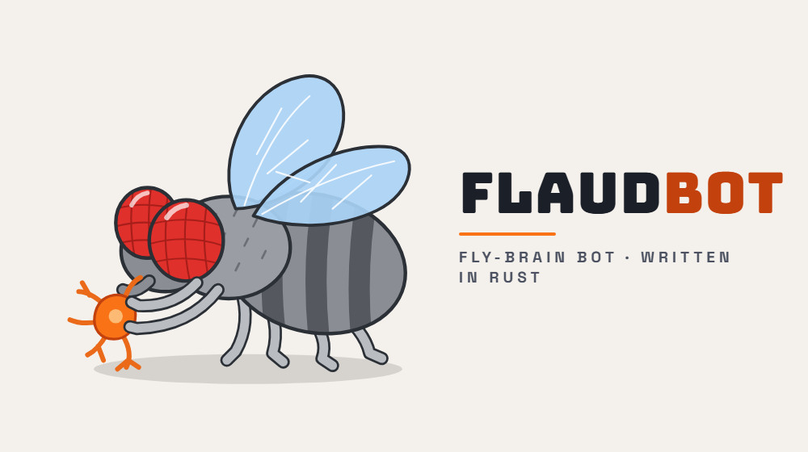

<p align="center">
  
</p>

# NetRTS(Flaud)

A bot for a simplified version of StarCraft (NetRTS) for the SnowCollege coding competition 2026-2027.

There are three bot implementations: one is algorithm-based, the second is driven by the open-source fly brain, and the third is a test bot based on the provided example bot.

- Flaud -- Fly Brain
- RustalaDaora -- Algorithm-Based
- TestBot -- Rust port of `example_bot.py`, used to check the API works end to end

## Running

Pass a bot name with `--name`. The API key is looked up in this order:

1. `--key` given on the command line
2. A `.env` entry with the same name as the bot, e.g.:

   ``` .env
   Flaud="TOTALLY_REAL_API_KEY"
   ```

   If `.env` has no such entry, an environment variable with that name is used instead (this is how Docker's `--env-file` passes keys). Blank values count as missing.
3. The `NETRTS_API_KEY` environment variable
4. If none of these exist, the bot is registered on the server under that name and its new key is appended to `.env` as `Name=KEY`, so the next run reuses it. The key is also printed once; if `.env` can't be written, add it there by hand. If the name is already taken, add its key to `.env`, pass its `--key`, or choose another `--name`.

``` shell
cargo run -- --name Flaud
```

The server defaults to `http://localhost:5080`; change it with `--server` or `NETRTS_SERVER`.

### Docker

The image points at `https://netrts.snowse.io`. Keys come from `.env` (Docker keeps quotes literally, so write `Flaud=KEY`, not `Flaud="KEY"`):

``` shell
docker build -t netrts-flaud .
docker run --rm -it --env-file .env netrts-flaud --name Flaud
```

Inside the container a newly registered key is saved to the container's own `.env`, which is lost when it exits, so copy the key into your local `.env` yourself.

### Menu

Use the arrow keys (or `w`/`s`, `k`/`j`) and Enter. `q` or Esc quits.

| Option | What it does |
| --- | --- |
| Create Game | Creates a match (see the options below) and plays it straight away, then prints the result. |
| Join Game | Asks for a match name or id (blank uses `--join`), joins it, plays it, then prints the result. A name is looked up in the server's match list, preferring one still waiting for players. |
| View Results | Asks for a match id (blank uses the last match) and prints the winner and each player's scores. |
| Change Bot | Asks for a bot name and loads its key from the environment variable of that name. |

While a match runs, the bot logs rejected commands, important events (`CommandFailed`, `BuildingCompleted`, `PlayerEliminated`) and its ore and unit count every 100 ticks.

### Match options

| Flag | Default | Effect |
| --- | --- | --- |
| `--vs <bot>` | `sitter` | House bot that Create Game plays against |
| `--create` | off | Create Game opens a match for other players instead |
| `--players <n>` | `2` | Seats in a match opened with `--create` |
| `--join <MATCH_ID>` | none | Default match id for Join Game |
| `--tick-ms <ms>` | server | Tick interval for a match you create |
| `--max-ticks <n>` | server | Tick limit for a match you create |
| `--seed <n>` | server | Map seed for a match you create |

`--vs`, `--create` and `--join` can't be combined. For example, to play `balanced` on a fixed map:

``` shell
cargo run -- --name Flaud --vs balanced --seed 1234 --max-ticks 2000
```

To get all possible arguments and what they do, run:

``` shell
cargo run -- --help
```

(or)

``` shell
NetRTS-Flaud-.exe --help
```

## Writing a bot

Bots implement the `Bot` trait in `src/logic/shared.rs`:

``` rust
fn new(map: MapDto, rules: RulesDto) -> Self;
fn decide(&mut self, state: &GameStateDto) -> Vec<CommandRequest>;
```

`new` is called once the match has started. `decide` is called every tick with the latest state, and the commands it returns are sent to the server. `src/bots/test_bot.rs` is a complete example. Menu matches currently run `TestBot` (see `play_match::<TestBot>()` in `src/ui/console.rs`).

## How Flaud works

Flaud splits its units into small groups and gives each group a tiny spiking-neuron brain (`FlyBrainConnectome` in `src/logic/connectome.rs`). Each tick, every brain feels the battlefield around its group and fires at most one action, which `Flaud::command` turns into a server command.

```
state ─▶ heat maps ─▶ senses at the group's centre ─▶ brain.tick ─▶ MotorAction ─▶ CommandRequest
```

### Heat maps

`src/logic/shared.rs` builds three heat maps each tick, on separate threads. Each source spreads heat over the tiles within `R` (9) of it, fading with Chebyshev distance, and each map is scaled so its hottest tile is 1.0.

| Map | Sources |
| --- | --- |
| `encode_threat` | Enemy combat units (Soldier, Archer, Scout) and enemy GuardTowers |
| `encode_sugar` | Resource deposits, weighted by ore remaining |
| `encode_prey` | Enemy workers, then enemy buildings: Barracks first, then CommandCenter and GuardTower, then the rest. Includes enemy buildings remembered from earlier sightings |

### Senses

A brain has four senses, `[threat, sugar, prey, wealth]`, each between 0 and 1. The first three are the heat maps read at the group's centre. Wealth is your resources as a share of the cheapest building cost, capped at 1.

### Role brains

Each sense neuron and motor neuron is a leaky integrate-and-fire neuron (`src/logic/neurons.rs`): it charges with input, leaks a little every tick, and fires when it crosses its threshold. Because voltage carries over between ticks, a group reacts to a threat that lasts, not to one passing enemy. If exactly one motor neuron fires, that's the action; if none or several fire, the group holds.

| Role | Units | Actions |
| --- | --- | --- |
| Worker | Workers | Retreat from threat, Gather (drawn to sugar, and always eventually), Build when rich and safe |
| Army | Soldiers and Archers | Attack threat, Explore toward prey, but never while fighting |
| Scout | Scouts | Retreat from threat, Explore when calm and sooner toward prey |

The weights are in `worker_brain`, `army_brain` and `scout_brain` in `src/bots/flaud.rs`.

### Groups

`update_groups` runs at the start of every tick. It removes dead units, drops empty groups, and puts new units in a group of their role with room (up to `GROUP_SIZE`, 5), or starts a new group with a fresh brain. Surviving groups keep their brain, so they keep their neuron voltages.

### From actions to commands

The server does the pathfinding, so each action only picks a destination:

| Action | Command | Destination |
| --- | --- | --- |
| Hold | none | — |
| Attack | attack-move | The hottest threat within `R` of the group (the fight it can feel), or where it stands |
| Retreat | move | Your CommandCenter, or directly away from the nearby threat if there is no CC |
| Gather | gather | The nearest deposit with ore left |
| Explore | attack-move (army), move (scout) | The hottest prey on the whole map, or the enemy start position if no prey is known |
| Build | build, with one worker | A site 3-6 tiles from your CC (`find_site`). A Barracks first, then GuardTowers, and only if you can afford it |

### Status

`Flaud::decide` runs the whole pipeline each tick. It also trains units with `spawn_units`: workers from the CC up to 12 (pausing at 6 to save for the first Barracks), then scouts and a soldier/archer mix from each Barracks. Commands are sorted by urgency (Retreat first) and cut to the server's free queue room. Next: tuning the brains against house bots in real matches.

## Changes

See [changelog.md](changelog.md).
